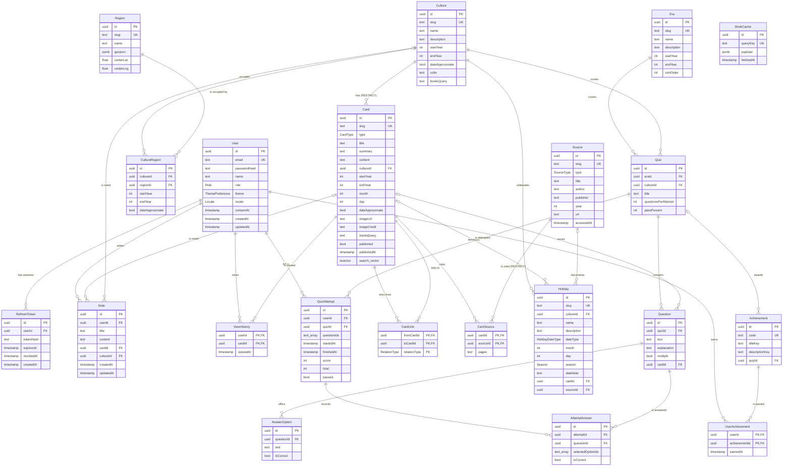

# Интерактивный атлас истории, мифологии и традиций народов мира: контекст для пояснительной записки

> Справочный файл со всеми сведениями о проекте, нужными для пояснительной записки и диаграмм (ER, классов, вариантов использования, последовательностей, состояний, компонентов, развёртывания).
> Источники данных: `apps/backend/prisma/schema.prisma`, миграции, сид-файлы, код модулей и спецификация проекта.
> Состояние на 13.10.2026: модули 0–10 закоммичены, модуль 11 (темы и язык) написан, но ещё не закоммичен. Модули 12 (админка) и 13 (расширенный контент) впереди.

---

## 1. Общие сведения

| Параметр | Значение |
|---|---|
| Тема | Интерактивный атлас истории, мифологии и традиций народов мира |
| Тип работы | Курсовая (с перспективой развития в дипломный проект) |
| Цель | Спроектировать и реализовать веб-приложение с реляционной БД для интерактивного изучения истории, мифологии и традиций через карту, временную шкалу и связанные тематические материалы |
| Объект исследования | Процесс изучения истории и культуры народов мира |
| Предмет исследования | Веб-приложение интерактивного атласа |
| Срок | 1–2 месяца с 05.10.2026 |
| Репозиторий | https://github.com/HannaKoval4/athlas (ветка `main`) |

**Идея.** Пользователь выбирает эпоху и год, видит на карте мира только те регионы, где в этот год существовала культура с материалами. По клику открывается культура и тематические карточки семи типов, связанные между собой. Пользователь ведёт заметки, проходит мини-тест по эпохе и получает достижение.

**Что важно показать на защите:**
- контент берётся из БД, а не зашит в код;
- реляционная модель продумана: временные периоды, связи M:N, ограничения CHECK, индексы;
- есть нетривиальные запросы: временной срез карты, полнотекстовый поиск, связи карточек, «случайная тема»;
- бизнес-правила проверяются на сервере;
- тестирование качественное: unit, e2e API и UI.

---

## 2. Функциональные требования (F-01…F-18) и статус

| ID | Функция | Описание | Модуль | Статус |
|---|---|---|---|---|
| F-01 | Регистрация и вход | Email + пароль, согласие на обработку ПД, JWT в httpOnly cookie | 2 | Готово |
| F-02 | Экран загрузки | «Подготавливаем карту и ваши заметки», только пока реально идут запросы | 3 | Готово |
| F-03 | Карта с временным срезом | Leaflet; подсвечены только регионы с материалами для выбранного года | 3 | Готово |
| F-04 | Панель эпохи и года | «Язычок» сверху: выбор эпохи + слайдер/ввод года; состояние в URL | 3 | Готово |
| F-05 | Культура и карточки | 7 типов карточек, связи, граф связей культуры, галерея | 4 | Готово |
| F-06 | Источники | Список источников у карточки; пометка «датировка приблизительная» | 4 | Готово |
| F-07 | Контекстные заметки | Заметки к карточке или культуре, правая панель, общий блокнот | 5 | Готово |
| F-08 | Экспорт заметок | Markdown и PDF (с кириллицей) | 5 | Готово |
| F-09 | Поиск и фильтры | Полнотекстовый поиск по карточкам, культурам, праздникам; фильтры: тип, культура, регион, годы | 6 | Готово |
| F-10 | Календарь праздников | Праздники из БД; подвижные и приблизительные даты помечены и объяснены | 7 | Готово |
| F-11 | «Сегодня в истории» | Точные праздники и датированные карточки на сегодня, иначе ближайшая дата | 7 | Готово |
| F-12 | «Случайная тема» | Только заполненная пара эпоха + культура, с объяснением выбора | 8 | Готово |
| F-13 | «Новое» | Недавно опубликованные карточки | 8 | Готово |
| F-14 | «Книги по теме» | Open Library через бэкенд, кэш 7 дней, graceful fallback | 10 | Готово |
| F-15 | Мини-тест по эпохе | 10 вопросов из пула, порог 70 %, без лимита попыток, лучший результат, разбор ошибок | 9 | Готово |
| F-16 | Достижение | «Эпоха изучена» за первое прохождение теста | 9 | Готово |
| F-17 | Профиль | Имя, email, пароль, тема (светлая/тёмная/системная), язык RU/EN, экспорт, история просмотров, достижения | 2, 4, 9, 11 | Готово (модуль 11 не закоммичен) |
| F-18 | Админка | CRUD всех сущностей, публикация карточек | 12 | В планах |

**Не входит в курсовую (бэклог диплома):** роль преподавателя; общий тест по всем эпохам; задания других типов (карта, шкала, сопоставление); расширенные достижения и статистика; рекомендации; музейные API (The Met); импорт материалов с модерацией; перевод контента на EN; совместная работа.

Архитектурные заделы под диплом: роль хранится как enum (легко добавить `TEACHER`), тип вопроса можно расширить полем `kind`, `Achievement` не привязан жёстко к тестам (`quizId` необязателен).

---

## 3. Акторы и варианты использования (для Use Case диаграммы)

### 3.1. Акторы

| Актор | Описание |
|---|---|
| Гость | Неавторизованный посетитель. Доступны только вход, регистрация и переключение языка/темы на странице входа |
| Пользователь (USER) | Изучает атлас, ведёт заметки, проходит тесты, управляет профилем |
| Администратор (ADMIN) | Всё, что может пользователь, плюс видит черновики и (модуль 12) управляет контентом |
| Open Library API | Внешняя система, источник списка книг |
| Система (планировщик не нужен) | Кэш книг обновляется по запросу, без фоновых задач |

### 3.2. Варианты использования

| ID | Вариант использования | Актор | Связанные F / BR |
|---|---|---|---|
| UC-01 | Зарегистрироваться | Гость | F-01, BR-01, BR-02 |
| UC-02 | Войти в систему | Гость | F-01, BR-03 |
| UC-03 | Выйти из системы | Пользователь | F-01 |
| UC-04 | Обновить сессию (refresh) | Пользователь (неявно, клиент) | BR-03 |
| UC-05 | Выбрать эпоху и год | Пользователь | F-04, BR-05 |
| UC-06 | Просмотреть карту временного среза | Пользователь | F-03, BR-04 |
| UC-07 | Открыть культуру региона | Пользователь | F-05 |
| UC-08 | Просмотреть граф связей культуры | Пользователь | F-05, DM-06 |
| UC-09 | Открыть карточку (источники, связи, книги) | Пользователь | F-05, F-06, F-14 |
| UC-10 | Создать / изменить / удалить заметку | Пользователь | F-07, BR-07 |
| UC-11 | Просмотреть общий блокнот | Пользователь | F-07 |
| UC-12 | Экспортировать заметки (MD / PDF) | Пользователь | F-08, BR-19 |
| UC-13 | Искать с фильтрами | Пользователь | F-09, BR-06 |
| UC-14 | Просмотреть календарь праздников | Пользователь | F-10 |
| UC-15 | Просмотреть «Сегодня в истории» | Пользователь | F-11, BR-15 |
| UC-16 | Получить случайную тему | Пользователь | F-12, BR-08 |
| UC-17 | Просмотреть «Новое» | Пользователь | F-13, DM-09 |
| UC-18 | Пройти мини-тест | Пользователь | F-15, BR-09…BR-12 |
| UC-19 | Просмотреть результат и разбор ошибок | Пользователь | F-15, BR-14 |
| UC-20 | Получить достижение | Пользователь (включается из UC-18) | F-16, BR-13 |
| UC-21 | Изменить профиль (имя, email) | Пользователь | F-17, BR-01 |
| UC-22 | Сменить пароль | Пользователь | F-17, BR-02, BR-03 |
| UC-23 | Сменить тему и язык | Гость, Пользователь | F-17 |
| UC-24 | Просмотреть историю просмотров | Пользователь | F-17, BR-20 |
| UC-25 | Получить книги по теме | Пользователь → Open Library | F-14, BR-16 |
| UC-26 | Управлять контентом (CRUD) | Администратор | F-18, BR-17, BR-18 (модуль 12) |
| UC-27 | Публиковать / снимать с публикации карточку | Администратор | F-18, DM-09 (модуль 12) |

Отношения: UC-09 «include» запись в историю просмотров (UC-24 источник данных); UC-18 «include» UC-19; UC-20 «extend» UC-18 (только при прохождении ≥70 %); UC-09 «extend» UC-25 (если у карточки задан `booksQuery`). Администратор наследует (generalization) Пользователя.

### 3.3. Основной сценарий (happy path)

1. Пользователь открывает приложение → страница входа / регистрации.
2. После входа показывается экран загрузки, пока параллельно грузятся эпохи, карта текущего года и «Сегодня в истории».
3. Главный экран: карта в центре, «язычок» эпохи/года сверху, панель заметок справа, навигация (Карта, Календарь, Поиск, Новое, Блокнот, Профиль).
4. Выбор эпохи «Античность» и года −450 → подсвечены регионы культур, существующих в этом году.
5. Клик по региону → список культур региона → «Древняя Греция».
6. Панель культуры: описание, вкладки типов карточек (карточки, период которых включает год), граф связей, галерея, тесты.
7. Карточка: текст, период, пометка о приблизительной датировке, источники, связанные карточки, «Книги по теме», заметки.
8. Заметка создаётся в правой панели, привязывается к карточке.
9. «Пройти тест по эпохе» → 10 вопросов → результат, разбор, достижение при ≥70 %.
10. Профиль: экспорт заметок, тема, язык, история просмотров, достижения.

Альтернативные сценарии: «Случайная тема» с главного экрана; переход из «Сегодня в истории» в карточку; поиск → карточка → «Показать на карте».

---

## 4. Архитектура

### 4.1. Общая схема (для диаграммы компонентов)

```
┌──────────────────────── Браузер ────────────────────────┐
│ React 19 SPA (Vite)                                     │
│  ├─ React Router (маршруты, guards RequireAuth/GuestOnly)│
│  ├─ TanStack Query (серверное состояние, кэш)           │
│  ├─ i18next (RU/EN), PreferencesProvider (тема/язык)    │
│  ├─ Leaflet / react-leaflet (карта, GeoJSON)            │
│  └─ shadcn/ui + Tailwind v4 (UI, тёмная тема .dark)     │
└──────────────┬──────────────────────────────────────────┘
               │ HTTPS/HTTP JSON, cookies (atlas_access, atlas_refresh)
               ▼
┌──────────── NestJS API (/api, Swagger /api/docs) ───────┐
│ helmet · CORS (только origin фронтенда) · cookieParser  │
│ ValidationPipe(whitelist, forbidNonWhitelisted)         │
│ Глобальные guards: JwtAuthGuard → RolesGuard            │
│ ThrottlerGuard на /auth (10 запросов/мин на IP и маршрут)│
│ Модули: auth, users, eras, map, cultures, cards, notes, │
│ search, calendar, random-topic, feed, history, quizzes, │
│ books, health                                           │
│ PrismaService (Prisma 7 + @prisma/adapter-pg)           │
└───────┬───────────────────────────────┬─────────────────┘
        │ SQL (Prisma + $queryRaw)       │ HTTPS, таймаут 5 с, User-Agent
        ▼                               ▼
┌──────────────────────┐        ┌──────────────────────┐
│ PostgreSQL 18        │        │ Open Library API     │
│ (Docker, atlas)      │        │ openlibrary.org      │
│ + atlas_test (tmpfs) │        └──────────────────────┘
└──────────────────────┘
```

### 4.2. Слои бэкенда

| Слой | Ответственность | Пример |
|---|---|---|
| Controller | Маршрут, DTO-валидация, Swagger, роль/публичность | `MapController` → `GET /api/map?year=` |
| DTO | Валидация входа (class-validator), форма ответа | `MapQueryDto`, `CardDetailsDto` |
| Service | Бизнес-правила | `QuizzesService.submit` (BR-10…BR-13) |
| Repository | Сложные SQL-запросы (`$queryRaw`) | `MapRepository.findActiveRegions`, `SearchRepository` |
| PrismaService | Подключение к БД, транзакции | `$transaction` при отправке попытки теста |
| Клиент внешнего API | HTTP, таймаут, нормализация | `OpenLibraryClient` |

### 4.3. Монорепозиторий

| Пакет | Назначение |
|---|---|
| `apps/backend` | NestJS API, Prisma-схема, миграции, сид, unit и e2e тесты |
| `apps/frontend` | React SPA, Playwright-тесты |
| `packages/shared` | Общие типы, enum-ы, константы, `formatYear()`, правила проверки (пароль, заметки, тесты) |

### 4.4. Модули бэкенда

| Модуль | Эндпоинты | Сущности БД |
|---|---|---|
| auth | `/auth/*` | User, RefreshToken |
| users | `/users/me`, `/users/me/password` | User |
| eras | `/eras` | Era |
| map | `/map` | Region, CultureRegion, Culture, Card |
| cultures | `/cultures`, `/cultures/:slug`, `/cultures/:slug/graph` | Culture, Card, CardLink |
| cards | `/cards`, `/cards/:slug` | Card, CardLink, CardSource, Source |
| notes | `/notes`, `/notes/export` | Note |
| search | `/search`, `/regions` | Card, Culture, Holiday, Region, CultureRegion |
| calendar | `/calendar/today`, `/holidays` | Holiday, Card |
| random | `/random-topic` | Era, Culture, Card, Quiz, QuizAttempt |
| feed | `/feed/new` | Card |
| history | `/users/me/history` | ViewHistory |
| quizzes | `/quizzes*`, `/users/me/achievements` | Quiz, Question, AnswerOption, QuizAttempt, AttemptAnswer, Achievement, UserAchievement |
| books | `/books` | BookCache, Card, Culture |
| health | `/health` | (проверка соединения с БД) |
| admin | `/admin/*` (модуль 12) | все контентные таблицы |

### 4.5. Развёртывание (для диаграммы развёртывания)

| Узел | Технология | Порт |
|---|---|---|
| Машина разработчика | Windows 11 + Docker Desktop (WSL2), Node.js ≥ 24.9 | – |
| Frontend dev-сервер | Vite | 5173 |
| Backend | NestJS (Node.js) | 3000 (`/api`, Swagger `/api/docs`) |
| Контейнер `atlas-postgres` | postgres:18-alpine, том `atlas-pgdata` | 5432 |
| Контейнер `atlas-postgres-test` | postgres:18-alpine, данные в tmpfs (одноразовые) | 5433 |
| Внешний сервис | Open Library (`https://openlibrary.org`) | 443 |

---

## 5. Технологический стек

| Слой | Технология (версия) | Обоснование |
|---|---|---|
| Монорепо | pnpm workspaces | Общие типы фронта и бэка в `packages/shared` |
| Язык | TypeScript ~6.0 (`strict`) | Типобезопасность на всех слоях |
| Backend | NestJS 12, Node.js ≥ 24.9 | Модульная архитектура, DI, guards, Swagger |
| ORM | Prisma 7.10 + `@prisma/adapter-pg` | Типизированный клиент, миграции; сложные запросы через `$queryRaw` |
| БД | PostgreSQL 18 | Реляционная модель, CHECK, GIN, full-text search (`russian`) |
| Валидация | class-validator 0.15, class-transformer | Глобальный `ValidationPipe` |
| Аутентификация | `@nestjs/jwt`, argon2 | JWT access + refresh в httpOnly cookie, хеш паролей argon2 |
| Безопасность | helmet, CORS, `@nestjs/throttler` | Заголовки, один origin, защита от перебора |
| PDF | pdfkit 0.20 + шрифт DejaVu | Генерация на сервере, корректная кириллица |
| API-документация | `@nestjs/swagger` | `/api/docs` |
| Frontend | React 19, Vite 8 | SPA, быстрая сборка |
| Роутинг | react-router 8 | Вложенные маршруты, guards |
| Данные | TanStack Query 5 | Кэш, инвалидация, оптимистичные обновления |
| UI | Tailwind CSS 4, shadcn/ui (Radix), lucide-react | Доступные компоненты, токены темы |
| Формы | react-hook-form 7 + zod 4 | Декларативная валидация |
| Карта | Leaflet 1.9 + react-leaflet 5 | GeoJSON-полигоны регионов из БД |
| i18n | i18next 26 + react-i18next 17 | Интерфейс RU/EN; контент только RU |
| Markdown | react-markdown 10 | Текст карточек хранится в Markdown |
| Unit / e2e API | Jest 30, Supertest 7 | Изолированная тестовая БД |
| UI-тесты | Playwright 1.63 | Пользовательские сценарии |
| Качество | ESLint 10, Prettier 3 | Единый стиль |
| Контейнеры | Docker Compose | Postgres dev + test |

---

## 6. Модель данных

### 6.1. Ключевые правила модели (DM-01…DM-10)

| ID | Правило |
|---|---|
| DM-01 | Год – `Int`. До н. э. – отрицательные значения (−527 = 527 г. до н. э.). Года 0 нет: после −1 идёт 1. Отображение – общая функция `formatYear()` (RU «527 г. до н. э.», EN «527 BCE»). Допустимый диапазон в API: −10000…2100 |
| DM-02 | Период = `startYear` + `endYear`, CHECK `startYear <= endYear` и оба ≠ 0 |
| DM-03 | «Существует в году X» ⇔ `startYear <= X AND endYear >= X`. «Пересекается с периодом [A, B]» ⇔ `startYear <= B AND endYear >= A` |
| DM-04 | `dateApproximate` у культуры, связи культура–регион и карточки → пометка «датировка приблизительная» |
| DM-05 | Праздник: `dateType` EXACT (month+day), SEASON (season), MOVABLE, APPROXIMATE; `dateNote` объясняет, почему дату нельзя указать точно |
| DM-06 | Связи карточек – одна таблица `CardLink`, составной PK `(fromCardId, toCardId, relationType)`, запрет ссылки на себя; связь показывается в обе стороны |
| DM-07 | Заметка ссылается на `cardId` и/или `cultureId`, хотя бы одно не NULL |
| DM-08 | Эпохи глобальные; тест уникален для пары эпоха + культура; границы эпох условные |
| DM-09 | Карточка видна пользователям только при `published = true`; «Новое» сортируется по `publishedAt` |
| DM-10 | Регион хранит упрощённый GeoJSON (`Json`); в интерфейсе подпись «границы условные» |

### 6.2. Сводка таблиц

| № | Таблица | Назначение | Тип сущности | PK | Строк в сиде |
|---|---|---|---|---|---|
| 1 | User | Учётная запись, роль, настройки | Справочник пользователей | `id` (uuid) | 2 (admin, demo) |
| 2 | RefreshToken | Хеши refresh-токенов (сессии) | Служебная | `id` | – (создаются при входе) |
| 3 | Era | Эпохи для «язычка» и тестов | Справочник | `id` | 3 |
| 4 | Culture | Культура / народ | Основная | `id` | 2 |
| 5 | Region | Географический регион (GeoJSON) | Справочник | `id` | 5 |
| 6 | CultureRegion | Какая культура занимала регион в какой период | Ассоциативная (M:N с атрибутами) | `id` | 5 |
| 7 | Card | Тематическая карточка | Основная | `id` | 30 |
| 8 | CardLink | Направленная связь карточек | Ассоциативная (рекурсивная M:N) | (`fromCardId`, `toCardId`, `relationType`) | 23 |
| 9 | Source | Источник (книга, музей, энциклопедия…) | Справочник | `id` | 20 |
| 10 | CardSource | Источники карточки | Ассоциативная (M:N) | (`cardId`, `sourceId`) | 59 |
| 11 | Holiday | Праздник культуры | Основная | `id` | 6 |
| 12 | Note | Личная заметка | Пользовательские данные | `id` | – |
| 13 | ViewHistory | История просмотров карточек | Ассоциативная (M:N User–Card) | (`userId`, `cardId`) | – |
| 14 | Quiz | Тест по паре эпоха + культура | Основная | `id` | 4 |
| 15 | Question | Вопрос теста | Основная | `id` | 64 |
| 16 | AnswerOption | Вариант ответа | Зависимая | `id` | 256 |
| 17 | QuizAttempt | Попытка прохождения | Пользовательские данные | `id` | – |
| 18 | AttemptAnswer | Ответ на вопрос в попытке | Зависимая | `id` | – |
| 19 | Achievement | Достижение (создаётся при первом прохождении) | Справочник | `id` | – |
| 20 | UserAchievement | Полученные достижения | Ассоциативная (M:N User–Achievement) | (`userId`, `achievementId`) | – |
| 21 | BookCache | Кэш ответов Open Library | Служебная | `id` | – |

Итого: 21 таблица, 8 перечислимых типов (enum), 15 ручных CHECK-ограничений, 1 генерируемая колонка `tsvector`, 1 GIN-индекс.


### 6.3. Перечислимые типы (enum)

| Enum | Значения | Где используется |
|---|---|---|
| Role | USER, ADMIN | User.role |
| ThemePreference | LIGHT, DARK, SYSTEM | User.theme |
| Locale | RU, EN | User.locale |
| CardType | MYTHOLOGY (мифология), EVENT (событие), TRADITION (традиция), FACT (интересный факт), ARTWORK (художественное произведение), PERSON (исторический деятель), ARTIFACT (артефакт) | Card.type |
| RelationType | RELATED (связано), PART_OF (часть), DEPICTS (изображает), CREATED_BY (создано), CELEBRATES (празднует), MENTIONS (упоминает) | CardLink.relationType |
| HolidayDateType | EXACT (точная дата), SEASON (сезон), MOVABLE (подвижная), APPROXIMATE (приблизительная) | Holiday.dateType |
| Season | SPRING, SUMMER, AUTUMN, WINTER | Holiday.season |
| SourceType | BOOK, ARTICLE, ENCYCLOPEDIA, MUSEUM, WEBSITE | Source.type |

### 6.4. Таблицы: поля

Обозначения: PK – первичный ключ, FK – внешний ключ, UQ – уникальный, NN – NOT NULL, IDX – индекс.

#### User – пользователь
| Поле | Тип | Ограничения | По умолчанию | Описание |
|---|---|---|---|---|
| id | uuid (text) | PK | uuid() | Идентификатор |
| email | text | NN, UQ, CHECK `email = lower(email)` | – | Email, хранится в нижнем регистре (BR-01), до 254 символов |
| passwordHash | text | NN | – | Хеш argon2 (BR-02) |
| name | text | NN | – | Имя, до 100 символов |
| role | Role | NN | USER | Роль |
| theme | ThemePreference | NN | SYSTEM | Тема интерфейса |
| locale | Locale | NN | RU | Язык интерфейса |
| consentAt | timestamp | NULL | – | Момент согласия на обработку ПД; NULL у пользователей из сида |
| createdAt | timestamp | NN | now() | Создан |
| updatedAt | timestamp | NN | авто | Изменён |

#### RefreshToken – сессия
| Поле | Тип | Ограничения | По умолчанию | Описание |
|---|---|---|---|---|
| id | uuid | PK | uuid() | Идентификатор (jti токена) |
| userId | uuid | FK → User (CASCADE), IDX | – | Владелец |
| tokenHash | text | NN | – | SHA-хеш refresh-токена (сам токен в БД не хранится) |
| expiresAt | timestamp | NN | – | Истечение (7 дней) |
| revokedAt | timestamp | NULL | – | Момент отзыва (ротация, logout, смена пароля, обнаружение повторного использования) |
| createdAt | timestamp | NN | now() | Выдан |

#### Era – эпоха
| Поле | Тип | Ограничения | По умолчанию | Описание |
|---|---|---|---|---|
| id | uuid | PK | uuid() | |
| slug | text | NN, UQ | – | Ключ для URL (`antiquity`) |
| name | text | NN | – | Название |
| description | text | NULL | – | Описание |
| startYear | int | NN, CHECK era_period_chk | – | Начало (отрицательное = до н. э.) |
| endYear | int | NN | – | Конец |
| sortOrder | int | NN | 0 | Порядок в списке |

#### Culture – культура
| Поле | Тип | Ограничения | По умолчанию | Описание |
|---|---|---|---|---|
| id | uuid | PK | uuid() | |
| slug | text | NN, UQ | – | `ancient-greece` |
| name | text | NN | – | Название |
| description | text | NN | – | Описание (Markdown-абзацы) |
| startYear, endYear | int | NN, CHECK culture_period_chk | – | Период существования |
| dateApproximate | boolean | NN | false | Датировка приблизительная |
| color | text | NN | – | HEX-цвет подсветки на карте |
| booksQuery | text | NULL | – | Английская фраза для Open Library; NULL = без блока книг |

#### Region – регион
| Поле | Тип | Ограничения | По умолчанию | Описание |
|---|---|---|---|---|
| id | uuid | PK | uuid() | |
| slug | text | NN, UQ | – | `nile-valley` |
| name | text | NN | – | Название |
| geojson | jsonb | NN | – | Упрощённая геометрия Polygon/MultiPolygon (границы условные) |
| centerLat, centerLng | double | NN | – | Центр для подписи и приближения |

#### CultureRegion – культура в регионе за период
| Поле | Тип | Ограничения | По умолчанию | Описание |
|---|---|---|---|---|
| id | uuid | PK | uuid() | |
| cultureId | uuid | FK → Culture (CASCADE) | – | |
| regionId | uuid | FK → Region (CASCADE) | – | |
| startYear, endYear | int | NN, CHECK cr_period_chk, IDX (startYear, endYear) | – | Период присутствия |
| dateApproximate | boolean | NN | false | |
| | | UQ (cultureId, regionId, startYear) | | Одна культура может занимать регион в разные периоды |

#### Card – карточка
| Поле | Тип | Ограничения | По умолчанию | Описание |
|---|---|---|---|---|
| id | uuid | PK | uuid() | |
| slug | text | NN, UQ | – | `battle-of-marathon` |
| type | CardType | NN, IDX (cultureId, type) | – | Тип карточки |
| title | text | NN | – | Заголовок |
| summary | text | NN | – | Краткое описание |
| content | text | NN | – | Текст в Markdown |
| cultureId | uuid | FK → Culture (RESTRICT) | – | Культура |
| startYear, endYear | int | NN, CHECK card_period_chk, IDX | – | Период |
| month, day | int | NULL, CHECK card_date_chk, IDX (month, day) | – | День в календаре для «Сегодня в истории» (оба или ни одного) |
| dateApproximate | boolean | NN | false | |
| imageUrl | text | NULL | – | Изображение (Wikimedia Commons) |
| imageCredit | text | NULL | – | Автор и лицензия изображения |
| booksQuery | text | NULL | – | Фраза для Open Library |
| published | boolean | NN, IDX (published, publishedAt) | false | Опубликована (DM-09) |
| publishedAt | timestamp | NULL | – | Дата публикации (для «Новое») |
| createdAt, updatedAt | timestamp | NN | now() / авто | |
| search_vector | tsvector | GENERATED ALWAYS … STORED, GIN-индекс `card_search_idx` | – | Вектор полнотекстового поиска: title (вес A), summary (B), content (C), конфигурация `russian` |

#### CardLink – связь карточек
| Поле | Тип | Ограничения | Описание |
|---|---|---|---|
| fromCardId | uuid | PK, FK → Card (CASCADE), CHECK cardlink_self_chk | Откуда |
| toCardId | uuid | PK, FK → Card (CASCADE), IDX | Куда |
| relationType | RelationType | PK | Тип связи |

#### Source – источник
| Поле | Тип | Ограничения | Описание |
|---|---|---|---|
| id | uuid | PK | |
| slug | text | NN, UQ | Стабильный ключ (для идемпотентного сида и админки) |
| type | SourceType | NN | Тип источника |
| title | text | NN | Название |
| author, publisher | text | NULL | Автор, издатель |
| year | int | NULL | Год издания |
| url | text | NULL | Ссылка |
| accessedAt | timestamp | NULL | Дата обращения (для веб-источников) |

#### CardSource – источник карточки
| Поле | Тип | Ограничения | Описание |
|---|---|---|---|
| cardId | uuid | PK, FK → Card (CASCADE) | |
| sourceId | uuid | PK, FK → Source (RESTRICT), IDX | Источник нельзя удалить, пока он привязан (BR-17) |
| pages | text | NULL | Страницы |

#### Holiday – праздник
| Поле | Тип | Ограничения | Описание |
|---|---|---|---|
| id | uuid | PK | |
| slug | text | NN, UQ | |
| cultureId | uuid | FK → Culture (CASCADE), IDX | Культура |
| name, description | text | NN | Название, описание |
| dateType | HolidayDateType | NN | Тип даты |
| month, day | int | NULL, CHECK holiday_exact_chk, holiday_date_range_chk, IDX (month, day) | Обязательны для EXACT |
| season | Season | NULL, CHECK holiday_season_chk | Обязателен для SEASON |
| dateNote | text | NULL | Почему дата подвижная / приблизительная |
| cardId | uuid | NULL, FK → Card (SET NULL) | Связанная карточка |
| sourceId | uuid | NULL, FK → Source (SET NULL) | Источник |

#### Note – заметка
| Поле | Тип | Ограничения | Описание |
|---|---|---|---|
| id | uuid | PK | |
| userId | uuid | FK → User (CASCADE), IDX (userId, cardId), IDX (userId, cultureId) | Владелец |
| title | text | NULL | Заголовок, до 200 символов |
| content | text | NN | Текст (Markdown), до 10 000 символов |
| cardId | uuid | NULL, FK → Card (SET NULL), CHECK note_target_chk | Карточка |
| cultureId | uuid | NULL, FK → Culture (SET NULL) | Культура (у заметки к карточке тоже заполняется: заметка переживает удаление карточки) |
| createdAt, updatedAt | timestamp | NN | |

#### ViewHistory – история просмотров
| Поле | Тип | Ограничения | Описание |
|---|---|---|---|
| userId | uuid | PK, FK → User (CASCADE), IDX (userId, viewedAt) | |
| cardId | uuid | PK, FK → Card (CASCADE) | |
| viewedAt | timestamp | NN, default now() | Обновляется при каждом просмотре (BR-20) |

#### Quiz – тест
| Поле | Тип | Ограничения | По умолчанию | Описание |
|---|---|---|---|---|
| id | uuid | PK | uuid() | |
| eraId | uuid | FK → Era (CASCADE) | – | |
| cultureId | uuid | FK → Culture (CASCADE) | – | |
| | | UQ (eraId, cultureId) | | Один тест на пару (DM-08) |
| title | text | NN | – | |
| questionsPerAttempt | int | NN, CHECK > 0 | 10 | Вопросов в попытке |
| passPercent | int | NN, CHECK 1…100 | 70 | Порог прохождения |

#### Question – вопрос
| Поле | Тип | Ограничения | По умолчанию | Описание |
|---|---|---|---|---|
| id | uuid | PK | uuid() | |
| quizId | uuid | FK → Quiz (CASCADE), IDX | – | |
| text | text | NN | – | Текст вопроса |
| explanation | text | NN | – | Пояснение для разбора |
| multiple | boolean | NN | false | Несколько правильных ответов |
| cardId | uuid | NULL, FK → Card (SET NULL) | – | Карточка для повторения |

#### AnswerOption – вариант ответа
| Поле | Тип | Ограничения | Описание |
|---|---|---|---|
| id | uuid | PK | |
| questionId | uuid | FK → Question (CASCADE), IDX | |
| text | text | NN | |
| isCorrect | boolean | NN | Никогда не отправляется клиенту до отправки ответов |

#### QuizAttempt – попытка
| Поле | Тип | Ограничения | Описание |
|---|---|---|---|
| id | uuid | PK | |
| userId | uuid | FK → User (CASCADE), IDX (userId, quizId) | |
| quizId | uuid | FK → Quiz (CASCADE) | |
| questionIds | text[] | NN | Выданные вопросы в порядке выдачи |
| startedAt | timestamp | NN, default now() | |
| finishedAt | timestamp | NULL | NULL = попытка не завершена |
| score | int | NULL | Правильных ответов |
| total | int | NN | Вопросов в попытке |
| passed | boolean | NULL | Пройдено ли |

#### AttemptAnswer – ответ в попытке
| Поле | Тип | Ограничения | Описание |
|---|---|---|---|
| id | uuid | PK | |
| attemptId | uuid | FK → QuizAttempt (CASCADE) | |
| questionId | uuid | FK → Question (CASCADE) | |
| | | UQ (attemptId, questionId) | Один ответ на вопрос |
| selectedOptionIds | text[] | NN | Выбранные варианты |
| isCorrect | boolean | NN | Результат серверной проверки |

#### Achievement – достижение
| Поле | Тип | Ограничения | Описание |
|---|---|---|---|
| id | uuid | PK | |
| code | text | NN, UQ | Код `ERA_STUDIED:<quizId>` |
| titleKey, descriptionKey | text | NN | i18n-ключи (`achievements.eraStudied`) |
| quizId | uuid | NULL, FK → Quiz (CASCADE) | Тест, за который выдаётся |

#### UserAchievement – полученное достижение
| Поле | Тип | Ограничения | Описание |
|---|---|---|---|
| userId | uuid | PK, FK → User (CASCADE) | |
| achievementId | uuid | PK, FK → Achievement (CASCADE) | Составной PK исключает дубли (BR-13) |
| earnedAt | timestamp | NN, default now() | |

#### BookCache – кэш Open Library
| Поле | Тип | Ограничения | Описание |
|---|---|---|---|
| id | uuid | PK | |
| queryKey | text | NN, UQ | Ключ: версия формата + нормализованная фраза |
| payload | jsonb | NN | До 5 книг (название, авторы, год, обложка, ссылка) |
| fetchedAt | timestamp | NN, default now() | Свежесть кэша (7 дней) |

### 6.5. Связи между таблицами (для ER-диаграммы)

| Родитель | Потомок | Кардинальность | FK | ON DELETE | Смысл |
|---|---|---|---|---|---|
| User | RefreshToken | 1 : N | userId | CASCADE | Сессии пользователя |
| User | Note | 1 : N | userId | CASCADE | Заметки |
| User | ViewHistory | 1 : N | userId | CASCADE | Просмотры |
| User | QuizAttempt | 1 : N | userId | CASCADE | Попытки тестов |
| User | UserAchievement | 1 : N | userId | CASCADE | Достижения |
| Culture | CultureRegion | 1 : N | cultureId | CASCADE | Культура ↔ регион (M:N через CultureRegion) |
| Region | CultureRegion | 1 : N | regionId | CASCADE | |
| Culture | Card | 1 : N | cultureId | RESTRICT | Нельзя удалить культуру с карточками (BR-17) |
| Card | CardLink (from) | 1 : N | fromCardId | CASCADE | Рекурсивная M:N Card ↔ Card |
| Card | CardLink (to) | 1 : N | toCardId | CASCADE | |
| Card | CardSource | 1 : N | cardId | CASCADE | Card ↔ Source (M:N) |
| Source | CardSource | 1 : N | sourceId | RESTRICT | Нельзя удалить используемый источник (BR-17) |
| Culture | Holiday | 1 : N | cultureId | CASCADE | Праздники культуры |
| Card | Holiday | 1 : 0..N | cardId | SET NULL | Карточка праздника (необязательна) |
| Source | Holiday | 1 : 0..N | sourceId | SET NULL | Источник праздника |
| Card | Note | 1 : 0..N | cardId | SET NULL | Заметка к карточке |
| Culture | Note | 1 : 0..N | cultureId | SET NULL | Заметка к культуре |
| Card | ViewHistory | 1 : N | cardId | CASCADE | User ↔ Card (M:N) |
| Era | Quiz | 1 : N | eraId | CASCADE | |
| Culture | Quiz | 1 : N | cultureId | CASCADE | Тест на пару эпоха + культура |
| Quiz | Question | 1 : N | quizId | CASCADE | Пул вопросов |
| Card | Question | 1 : 0..N | cardId | SET NULL | Карточка для повторения |
| Question | AnswerOption | 1 : N | questionId | CASCADE | Варианты |
| Quiz | QuizAttempt | 1 : N | quizId | CASCADE | |
| QuizAttempt | AttemptAnswer | 1 : N | attemptId | CASCADE | |
| Question | AttemptAnswer | 1 : N | questionId | CASCADE | |
| Quiz | Achievement | 1 : 0..N | quizId | CASCADE | |
| Achievement | UserAchievement | 1 : N | achievementId | CASCADE | User ↔ Achievement (M:N) |

Связи многие-ко-многим: Culture ↔ Region (через CultureRegion, с периодом), Card ↔ Card (CardLink, с типом связи), Card ↔ Source (CardSource, со страницами), User ↔ Card (ViewHistory, с датой просмотра), User ↔ Achievement (UserAchievement, с датой получения).

### 6.6. ER-диаграмма (Mermaid)

Можно вставить в https://mermaid.live, в draw.io (Arrange → Insert → Advanced → Mermaid) или в любой редактор с поддержкой Mermaid.



### 6.7. Ограничения целостности CHECK (добавлены вручную в SQL миграции)

| Имя | Таблица | Условие | Правило |
|---|---|---|---|
| user_email_lower_chk | User | `email = lower(email)` | BR-01 |
| era_period_chk | Era | `startYear <= endYear AND startYear <> 0 AND endYear <> 0` | DM-01, DM-02 |
| culture_period_chk | Culture | то же | DM-01, DM-02 |
| cr_period_chk | CultureRegion | то же | DM-01, DM-02 |
| card_period_chk | Card | то же | DM-01, DM-02 |
| card_date_chk | Card | `(month IS NULL AND day IS NULL) OR (month IS NOT NULL AND day IS NOT NULL AND month BETWEEN 1 AND 12 AND day BETWEEN 1 AND 31)` | «Сегодня в истории» |
| cardlink_self_chk | CardLink | `fromCardId <> toCardId` | DM-06 |
| note_target_chk | Note | `cardId IS NOT NULL OR cultureId IS NOT NULL` | DM-07 |
| holiday_exact_chk | Holiday | `dateType <> 'EXACT' OR (month IS NOT NULL AND day IS NOT NULL AND month BETWEEN 1 AND 12 AND day BETWEEN 1 AND 31)` | DM-05 |
| holiday_season_chk | Holiday | `dateType <> 'SEASON' OR season IS NOT NULL` | DM-05 |
| holiday_date_range_chk | Holiday | `(month IS NULL OR month BETWEEN 1 AND 12) AND (day IS NULL OR day BETWEEN 1 AND 31)` | DM-05 |
| quiz_pass_chk | Quiz | `passPercent BETWEEN 1 AND 100` | F-15 |
| quiz_questions_chk | Quiz | `questionsPerAttempt > 0` | F-15 |

**Найденный тестами дефект (для главы «Тестирование»).** В первой версии `card_date_chk` и `holiday_exact_chk` пропускали неполные даты: в SQL `NULL BETWEEN 1 AND 31` даёт NULL, а CHECK со значением NULL считается выполненным. Поэтому `month = 5, day = NULL` проходило проверку. Дефект нашли e2e-тесты ограничений (`test/db/constraints.e2e-spec.ts`). Исправлен отдельной миграцией `20261005160000_fix_date_check_nulls` с явным `IS NOT NULL`.

### 6.8. Индексы

| Индекс | Таблица | Поля | Тип | Для чего |
|---|---|---|---|---|
| User_email_key | User | email | UNIQUE B-tree | Вход, уникальность |
| RefreshToken_userId_idx | RefreshToken | userId | B-tree | Отзыв всех сессий |
| Era/Culture/Region/Card/Source/Holiday `_slug_key` | разные | slug | UNIQUE | Адреса в URL, идемпотентный сид |
| CultureRegion_startYear_endYear_idx | CultureRegion | startYear, endYear | B-tree | Временной срез карты |
| CultureRegion_cultureId_regionId_startYear_key | CultureRegion | cultureId, regionId, startYear | UNIQUE | Без дублей периодов |
| Card_cultureId_type_idx | Card | cultureId, type | B-tree | Вкладки типов в панели культуры |
| Card_startYear_endYear_idx | Card | startYear, endYear | B-tree | Фильтр по году |
| Card_published_publishedAt_idx | Card | published, publishedAt | B-tree | Лента «Новое» |
| Card_month_day_idx | Card | month, day | B-tree | «Сегодня в истории» |
| card_search_idx | Card | search_vector | GIN | Полнотекстовый поиск |
| CardLink_toCardId_idx | CardLink | toCardId | B-tree | Обратные связи (PK начинается с fromCardId) |
| CardSource_sourceId_idx | CardSource | sourceId | B-tree | Проверка использования источника |
| Holiday_month_day_idx | Holiday | month, day | B-tree | Календарь, «Сегодня в истории» |
| Holiday_cultureId_idx | Holiday | cultureId | B-tree | Фильтр по культуре |
| Note_userId_cardId_idx, Note_userId_cultureId_idx | Note | userId + cardId / cultureId | B-tree | Заметки к карточке / культуре |
| ViewHistory_userId_viewedAt_idx | ViewHistory | userId, viewedAt | B-tree | Последние 20 просмотров |
| Quiz_eraId_cultureId_key | Quiz | eraId, cultureId | UNIQUE | Один тест на пару |
| Question_quizId_idx | Question | quizId | B-tree | Пул вопросов |
| AnswerOption_questionId_idx | AnswerOption | questionId | B-tree | Варианты вопроса |
| QuizAttempt_userId_quizId_idx | QuizAttempt | userId, quizId | B-tree | Лучший результат |
| AttemptAnswer_attemptId_questionId_key | AttemptAnswer | attemptId, questionId | UNIQUE | Один ответ на вопрос |
| Achievement_code_key | Achievement | code | UNIQUE | Одно достижение на тест |
| BookCache_queryKey_key | BookCache | queryKey | UNIQUE | Поиск в кэше |

### 6.9. Миграции

| Миграция | Что делает |
|---|---|
| 20261005142402_init | Все таблицы, enum-ы, FK, индексы; вручную: CHECK-ограничения, колонка `search_vector` (GENERATED … STORED) и GIN-индекс |
| 20261005160000_fix_date_check_nulls | Исправление CHECK для неполных дат (см. 6.7) |
| 20261007123702_user_consent_at | `User.consentAt` – согласие на обработку персональных данных |
| 20261009100000_books_query | `Card.booksQuery`, `Culture.booksQuery` для Open Library |

### 6.10. Нормализация (для записки)

- Все таблицы в 3НФ: неключевые атрибуты зависят только от ключа. Справочные данные (эпохи, регионы, источники) вынесены в отдельные таблицы и связаны через FK.
- Связи M:N с атрибутами оформлены ассоциативными таблицами: период в CultureRegion, тип связи в CardLink, страницы в CardSource, дата просмотра в ViewHistory, дата получения в UserAchievement.
- Осознанная денормализация:
  - `Note.cultureId` заполняется и у заметки к карточке, чтобы заметка оставалась в панели культуры и переживала удаление карточки;
  - `QuizAttempt.questionIds` (массив) фиксирует порядок выданных вопросов;
  - `Card.search_vector` – вычисляемая хранимая колонка ради скорости поиска.

---

## 7. Бизнес-правила (BR-01…BR-20)

| ID | Правило | Где реализовано | Статус |
|---|---|---|---|
| BR-01 | Email уникален без учёта регистра (хранится в lower-case) | DTO-нормализация + CHECK + UNIQUE | Готово |
| BR-02 | Пароль 8–128 символов, минимум одна буква и одна цифра; хеш argon2 | `packages/shared` (PASSWORD_PATTERN), DTO, PasswordService | Готово |
| BR-03 | Access ~15 мин, refresh ~7 дней; ротация refresh; повторное использование отозванного refresh → отзыв всех сессий | TokenService | Готово |
| BR-04 | На карте года X – только регионы с CultureRegion, активной в X, у культуры которой есть опубликованная карточка | MapRepository | Готово |
| BR-05 | Год вне диапазона → 400 (клиент ограничивает слайдер границами эпохи) | MapQueryDto, EraYearBar | Готово |
| BR-06 | Пользователь видит только опубликованные карточки; admin – все; черновик для пользователя = 404 | card-visibility.ts, все сервисы | Готово |
| BR-07 | Чужая заметка → 404 (не 403) | NotesService (все запросы с userId) | Готово |
| BR-08 | «Случайная тема» – только пары эпоха + культура с ≥1 опубликованной карточкой в пересечении периодов; приоритет – тесты, которые пользователь ещё не прошёл; ответ содержит причину | RandomTopicService, pickTopic | Готово |
| BR-09 | Попытка: `questionsPerAttempt` случайных вопросов (или весь пул), варианты перемешаны (Фишер–Йетс) | draw.ts | Готово |
| BR-10 | Проверка только на сервере; вопрос с несколькими ответами засчитывается при точном совпадении множеств | QuizzesService, isExactMatch | Готово |
| BR-11 | Пройдено, если `score / total * 100 >= passPercent`; повторная отправка → 409 | isPassed, условный UPDATE | Готово |
| BR-12 | Лучший результат = максимум score по завершённым попыткам | bestResult | Готово |
| BR-13 | «Эпоха изучена» выдаётся один раз | upsert + составной PK + skipDuplicates | Готово |
| BR-14 | Разбор: правильные варианты, пояснение, ссылка на карточку | QuizzesService.result | Готово |
| BR-15 | «Сегодня в истории» – только EXACT-праздники и карточки с month/day; если пусто – ближайший следующий день | CalendarService | Готово |
| BR-16 | Open Library только с бэкенда, таймаут 5 с, кэш 7 дней, максимум 5 книг; при ошибке – устаревший кэш или пустой список, блок скрыт | BooksService, OpenLibraryClient | Готово |
| BR-17 | Удаление культуры с карточками и используемого источника → 409 | FK RESTRICT (готово), понятный 409 в админке | Модуль 12 |
| BR-18 | Нельзя создать связь карточки с собой и дубль связи → 400/409 | CHECK + PK (готово), API админки | Модуль 12 |
| BR-19 | Экспорт – только свои заметки, группировка культура → карточка, дата создания, кириллица в PDF | notes-export.ts | Готово |
| BR-20 | Одна запись истории на карточку (обновляется viewedAt), в профиле – последние 20 | HistoryService | Готово |

---

## 8. API (префикс `/api`)

Все ответы в JSON. Ошибки – стандартные исключения Nest (400/401/403/404/409) с понятным `message`. Все маршруты, кроме отмеченных «публичный», требуют access-cookie (глобальный `JwtAuthGuard`). Пагинация: `?page=1&pageSize=20` (максимум 100) → `{ items, total, page, pageSize }`.

| № | Метод | Путь | Параметры | Описание | Доступ | Ответы-ошибки |
|---|---|---|---|---|---|---|
| 1 | GET | `/health` | – | Проверка API и БД | публичный | 503 |
| 2 | POST | `/auth/register` | email, password, name, consent | Регистрация, ставит cookies | публичный, throttling | 400, 409, 429 |
| 3 | POST | `/auth/login` | email, password | Вход, ставит cookies | публичный, throttling | 400, 401, 429 |
| 4 | POST | `/auth/refresh` | refresh-cookie | Ротация токенов | публичный, throttling | 401, 429 |
| 5 | POST | `/auth/logout` | refresh-cookie | Отзыв refresh, очистка cookies (204) | публичный | – |
| 6 | GET | `/auth/me` | – | Текущий пользователь | user | 401 |
| 7 | PATCH | `/users/me` | name?, email?, theme?, locale? | Изменение профиля | user | 400, 409 |
| 8 | PATCH | `/users/me/password` | currentPassword, newPassword | Смена пароля, отзыв других сессий (204) | user | 400, 401 |
| 9 | GET | `/users/me/history` | – | Последние 20 просмотренных карточек | user | – |
| 10 | POST | `/users/me/history` | cardId | Отметить просмотр (204) | user | 404 |
| 11 | GET | `/users/me/achievements` | – | Достижения | user | – |
| 12 | GET | `/eras` | – | Эпохи по sortOrder | user | – |
| 13 | GET | `/map` | year | Временной срез: регионы + культуры | user | 400 |
| 14 | GET | `/regions` | – | Регионы (для фильтра поиска) | user | – |
| 15 | GET | `/cultures` | – | Все культуры | user | – |
| 16 | GET | `/cultures/:slug` | year? | Культура + количество карточек по типам | user | 404 |
| 17 | GET | `/cultures/:slug/graph` | year? | Граф связей карточек культуры | user | 404 |
| 18 | GET | `/cards` | cultureId, type, year, eraId, page, pageSize | Список карточек | user | 400 |
| 19 | GET | `/cards/:slug` | – | Карточка + источники + связи в обе стороны | user | 404 |
| 20 | GET | `/search` | q, type, cultureId, regionId, yearFrom, yearTo, page | FTS: карточки (с пагинацией), культуры и праздники (до 10) | user | 400 |
| 21 | GET | `/calendar/today` | today? (дата клиента) | «Сегодня в истории» или ближайшая дата | user | 400 |
| 22 | GET | `/holidays` | cultureId?, month? | Календарь праздников | user | 400 |
| 23 | GET | `/random-topic` | – | `{ era, culture, cardsCount, reason, … }` | user | 404 |
| 24 | GET | `/feed/new` | limit (по умолчанию 10, до 50) | Последние опубликованные карточки | user | 400 |
| 25 | GET | `/books` | cardId или cultureId | До 5 книг Open Library | user | 400, 404 |
| 26 | GET | `/notes` | cardId?, cultureId? | Заметки пользователя | user | – |
| 27 | POST | `/notes` | content, title?, cardId?, cultureId? | Создать заметку | user | 400, 404 |
| 28 | PATCH | `/notes/:id` | content?, title? | Изменить свою | user | 400, 404 |
| 29 | DELETE | `/notes/:id` | – | Удалить свою (204) | user | 404 |
| 30 | GET | `/notes/export` | format = md \| pdf, lang | Файл заметок | user | 400 |
| 31 | GET | `/quizzes` | eraId?, cultureId? | Тесты + лучший результат | user | – |
| 32 | GET | `/quizzes/:id` | – | Описание теста | user | 404 |
| 33 | POST | `/quizzes/:id/attempts` | – | Новая попытка: вопросы без `isCorrect` | user | 404 |
| 34 | POST | `/quizzes/attempts/:id/submit` | answers: [{ questionId, optionIds[] }] | Проверка, результат, достижение | user | 400, 404, 409 |
| 35 | GET | `/quizzes/attempts/:id` | – | Результат и разбор своей попытки | user | 404 |
| – | CRUD | `/admin/eras`, `/admin/cultures`, `/admin/regions`, `/admin/culture-regions`, `/admin/cards` (+ publish/unpublish), `/admin/card-links`, `/admin/sources`, `/admin/card-sources`, `/admin/holidays`, `/admin/quizzes`, `/admin/questions` | – | Админка | admin (иначе 403) | модуль 12 |

**Cookies:**

| Cookie | Содержимое | Path | Флаги | Срок |
|---|---|---|---|---|
| atlas_access | Access JWT | `/api` | httpOnly, SameSite=Lax, Secure в production | 15 мин |
| atlas_refresh | Refresh JWT | `/api/auth` (браузер шлёт его только на refresh/logout) | httpOnly, SameSite=Lax, Secure в production | 7 дней |

---

## 9. Ключевые SQL-запросы (для главы «Реализация»)

### 9.1. Временной срез карты (BR-04, DM-03)

Один запрос возвращает регионы, активные в году, вместе с вложенным массивом культур. CTE `active` оставляет одну строку на пару (регион, культура). `EXISTS` прекращает поиск на первой опубликованной карточке. `json_agg` собирает вложенный массив прямо в БД, поэтому нет отдельного запроса на каждый регион (проблема N+1).

```sql
WITH active AS (
  SELECT cr."regionId", cr."cultureId",
         bool_or(cr."dateApproximate") AS "dateApproximate"
  FROM "CultureRegion" cr
  WHERE cr."startYear" <= $year AND cr."endYear" >= $year
    AND EXISTS (SELECT 1 FROM "Card" card
                WHERE card."cultureId" = cr."cultureId" AND card.published)
  GROUP BY cr."regionId", cr."cultureId"
)
SELECT r.id, r.slug, r.name, r.geojson, r."centerLat", r."centerLng",
       json_agg(json_build_object('id', c.id, 'slug', c.slug, 'name', c.name,
                'color', c.color, 'dateApproximate', a."dateApproximate")
                ORDER BY c.name) AS cultures
FROM active a
JOIN "Region" r ON r.id = a."regionId"
JOIN "Culture" c ON c.id = a."cultureId"
GROUP BY r.id
ORDER BY r.name;
```

### 9.2. Полнотекстовый поиск по карточкам (F-09)

Хранимая колонка `search_vector` с GIN-индексом, веса title A > summary B > content C, русская морфология (стемминг). Фрагмент с подсветкой даёт `ts_headline`, ранжирование – `ts_rank`. Фильтры собираются через `Prisma.sql`, поэтому все значения передаются параметрами, а не подставляются в текст запроса (защита от SQL-инъекций).

```sql
SELECT card.id, card.slug, card.type, card.title, card.summary,
       card."startYear", card."endYear", card."dateApproximate",
       json_build_object('id', c.id, 'slug', c.slug, 'name', c.name, 'color', c.color) AS culture,
       ts_headline('russian', card.summary || ' ' || card.content, $query,
                   'MaxWords=24, MinWords=12, MaxFragments=1') AS snippet
FROM "Card" card
JOIN "Culture" c ON c.id = card."cultureId"
WHERE card.published
  AND card.search_vector @@ $query                -- to_tsquery('russian', 'слово:*' & ...)
  AND card.type = $type::"CardType"               -- если задан
  AND card."cultureId" = $cultureId               -- если задан
  AND card."startYear" <= $yearTo AND card."endYear" >= $yearFrom   -- пересечение периодов
  AND EXISTS (SELECT 1 FROM "CultureRegion" cr                      -- если задан регион
              WHERE cr."cultureId" = card."cultureId" AND cr."regionId" = $regionId
                AND cr."startYear" <= $yearTo AND cr."endYear" >= $yearFrom)
ORDER BY ts_rank(card.search_vector, $query) DESC, card.title
LIMIT $take OFFSET $skip;
```

Колонка поиска (из миграции):
```sql
"search_vector" tsvector GENERATED ALWAYS AS (
    setweight(to_tsvector('russian', coalesce("title", '')), 'A') ||
    setweight(to_tsvector('russian', coalesce("summary", '')), 'B') ||
    setweight(to_tsvector('russian', coalesce("content", '')), 'C')
) STORED;
CREATE INDEX card_search_idx ON "Card" USING GIN ("search_vector");
```

Культуры и праздники ищутся по вектору, который строится на лету (name A, description B): строк немного, индекс не нужен.

### 9.3. Кандидаты для «Случайной темы» (BR-08)

Соединение эпох и культур по пересечению периодов. Карточка учитывается, если её период пересекает пересечение [GREATEST(начал), LEAST(концов)]. Для каждой пары считаются карточки и проверяется, прошёл ли пользователь тест.

```sql
SELECT json_build_object('id', e.id, 'slug', e.slug, 'name', e.name) AS era,
       json_build_object('id', c.id, 'slug', c.slug, 'name', c.name, 'color', c.color) AS culture,
       GREATEST(e."startYear", c."startYear") AS "fromYear",
       LEAST(e."endYear", c."endYear")       AS "toYear",
       COUNT(card.id)::int AS "cardsCount",
       (q.id IS NOT NULL) AS "hasQuiz",
       EXISTS (SELECT 1 FROM "QuizAttempt" a
               WHERE a."quizId" = q.id AND a."userId" = $userId AND a.passed) AS "quizPassed"
FROM "Era" e
JOIN "Culture" c ON c."startYear" <= e."endYear" AND c."endYear" >= e."startYear"
JOIN "Card" card ON card."cultureId" = c.id AND card.published
 AND card."startYear" <= LEAST(e."endYear", c."endYear")
 AND card."endYear"   >= GREATEST(e."startYear", c."startYear")
LEFT JOIN "Quiz" q ON q."eraId" = e.id AND q."cultureId" = c.id
GROUP BY e.id, c.id, q.id
ORDER BY e."sortOrder", e."startYear", c.name;
```
Выбор делает чистая функция `pickTopic`: случайная пара из тех, где тест не пройден; если пройдены все, то из всех пар.

### 9.4. Ближайший день с датированными событиями (BR-15)

Даты сравниваются как `month * 100 + day`. Дни раньше сегодняшнего сортируются после остальных (`false < true`), поэтому поиск переходит через конец года.

```sql
SELECT month, day FROM (
  SELECT month, day FROM "Holiday" WHERE "dateType" = 'EXACT'
  UNION
  SELECT month, day FROM "Card" WHERE month IS NOT NULL AND day IS NOT NULL AND published
) AS dated
ORDER BY (month * 100 + day < $fromKey), month, day
LIMIT 1;
```

### 9.5. Завершение попытки теста (BR-11, BR-13) – транзакция

```sql
-- 1. Условное обновление: завершить можно только незавершённую попытку.
UPDATE "QuizAttempt" SET "finishedAt" = now(), score = $score, total = $total, passed = $passed
WHERE id = $attemptId AND "finishedAt" IS NULL;      -- 0 строк → 409 Conflict
-- 2. Ответы
INSERT INTO "AttemptAnswer" (...) VALUES (...);
-- 3. Если пройдено: достижение (upsert по code) и выдача без дублей
INSERT INTO "Achievement" (code, ...) VALUES (...) ON CONFLICT (code) DO NOTHING;
INSERT INTO "UserAchievement" ("userId", "achievementId") VALUES (...) ON CONFLICT DO NOTHING;
```
Проверка и обновление выполняются одним условным UPDATE, поэтому две параллельные отправки не могут обе завершиться успешно.

### 9.6. Прочие запросы (Prisma)

| Задача | Запрос |
|---|---|
| Счётчики карточек культуры по типам | `groupBy({ by: ['type'], where: { cultureId, published, startYear <= X, endYear >= X }, _count })` – один GROUP BY вместо семи COUNT |
| Граф культуры | Карточки культуры (видимые, в году) + `CardLink`, у которых оба конца среди этих карточек |
| Связи карточки в обе стороны | `linksFrom` + `linksTo` с фильтром `published` у второй стороны |
| История просмотров | `upsert` по (userId, cardId) с обновлением `viewedAt`; чтение `orderBy viewedAt desc take 20` |
| Лента «Новое» | `where published, orderBy publishedAt desc, take limit` |
| Лучший результат | Максимум `score` среди `finishedAt IS NOT NULL` |

---

## 10. Диаграммы процессов (подсказки для последовательностей и состояний)

### 10.1. Вход и обновление сессии (sequence)

1. Клиент → `POST /api/auth/login {email, password}`.
2. AuthService: email → lower-case → поиск User → `argon2.verify`. При ошибке 401 «Invalid e-mail or password»: один и тот же ответ для неизвестного email и неверного пароля.
3. TokenService.issue: access JWT (15 мин) + refresh JWT (7 дней); в `RefreshToken` сохраняется хеш refresh.
4. Ответ: `Set-Cookie atlas_access` (path `/api`), `atlas_refresh` (path `/api/auth`), тело – профиль.
5. Каждый запрос: `JwtAuthGuard` проверяет access-cookie → `RolesGuard` проверяет роль.
6. Access истёк → 401 → клиент один раз вызывает `POST /auth/refresh` и повторяет запрос.
7. Rotate: токен найден и не отозван → отозвать его, выдать новую пару. Токен уже был отозван → это повторное использование (кража): отозвать все сессии пользователя → 401.

### 10.2. Открытие карты (sequence)

Браузер → `GET /eras` → выбор эпохи/года (URL `?era=antiquity&year=-450`) → `GET /map?year=-450` → MapService → MapRepository (SQL 9.1) → PostgreSQL → JSON `[{region, geojson, cultures[]}]` → Leaflet рисует полигоны цветом культуры. Клик по региону → список культур → `/cultures/:slug` → `GET /cultures/:slug?year=` + `/cultures/:slug/graph` + `/quizzes?cultureId=`.

### 10.3. «Книги по теме» (sequence / activity)

1. `GET /books?cardId=` → у карточки нет `booksQuery` → пустой список, блок скрыт.
2. Ключ кэша → `BookCache` найден и моложе 7 дней → ответ из кэша.
3. Иначе запрос к Open Library `search.json` (таймаут 5 с, User-Agent с контактом) → до 5 книг → upsert в `BookCache` (пустой ответ тоже кэшируется).
4. Ошибка или таймаут → устаревший кэш, если он есть, иначе пустой список. Ошибки не кэшируются.

### 10.4. Прохождение теста (sequence)

1. `POST /quizzes/:id/attempts` → случайные 10 вопросов из пула, перемешанные варианты → `QuizAttempt(questionIds, total)` → вопросы без `isCorrect`.
2. Пользователь отвечает → `POST /quizzes/attempts/:id/submit {answers}`.
3. Сервер: попытка своя (иначе 404) → ответы только на вопросы попытки → точное совпадение множеств → score, passed.
4. Транзакция 9.5 → ответ: результат, разбор, `newAchievement` (или null).
5. `GET /quizzes/attempts/:id` – повторный просмотр результата.

### 10.5. Диаграммы состояний

**QuizAttempt:**

| Состояние | Признак | Переход |
|---|---|---|
| Начата | `finishedAt IS NULL` | submit → Завершена |
| Завершена (не пройдена) | `finishedAt NOT NULL, passed = false` | – (новая попытка создаётся отдельно) |
| Завершена (пройдена) | `passed = true` | при первом прохождении → выдача достижения |
| Повторная отправка | – | 409 Conflict |

**Card:** Черновик (`published = false`, видна только admin) ⇄ Опубликована (`published = true`, `publishedAt` задан, видна всем, попадает в «Новое», поиск и на карту).

**RefreshToken:** Активен → (refresh) Отозван → (повторное предъявление) все токены пользователя отозваны. Активен → (истёк `expiresAt`) Недействителен. Активен → (logout / смена пароля) Отозван.

**Тема интерфейса:** LIGHT → DARK → SYSTEM → LIGHT (кнопка в шапке). SYSTEM следует за настройкой ОС (`prefers-color-scheme`) без перезагрузки.

### 10.6. Тема и язык (модуль 11)

- Источник истины – профиль в БД (`User.theme`, `User.locale`). Копия в `localStorage` нужна для первой отрисовки без мигания и для гостей.
- Скрипт в `index.html` ставит класс `dark` до загрузки React.
- `PreferencesProvider` применяет выбор: класс `dark`, `color-scheme`, `i18n.changeLanguage`, `lang` у `<html>`. Сохраняет оптимистично: кэш TanStack Query меняется сразу, затем `PATCH /users/me`, при ошибке профиль перечитывается.

---

## 11. Фронтенд: маршруты и экраны

| Маршрут | Экран | Доступ | Основные компоненты |
|---|---|---|---|
| `/login`, `/register` | Вход, регистрация (с согласием на обработку ПД) | гость (GuestOnly) | AuthPages, PreferenceSwitches |
| `/` | Карта (главный экран) | user (RequireAuth) | MapPage, AtlasMap, EraYearBar, RegionPanel, NotesPanel, TodayInHistory, RandomTopicButton |
| `/cultures/:slug` | Панель культуры (drawer поверх карты) | user | CultureSheet, CultureGraph, CultureGallery, CultureQuizzes |
| `/cards/:slug` | Карточка | user | CardPage, BooksBlock, NotesPanel |
| `/calendar` | Календарь праздников + «Сегодня в истории» | user | CalendarPage |
| `/search` | Поиск с фильтрами | user | SearchPage |
| `/new` | Новое в атласе | user | NewPage |
| `/notes` | Общий блокнот, экспорт | user | NotesPage, ExportNotes |
| `/quizzes/:id` | Прохождение теста | user | QuizPage, QuizProgress |
| `/quizzes/attempts/:id` | Результат и разбор | user | AttemptPage |
| `/profile` | Профиль, оформление и язык, пароль, достижения, история | user | ProfilePage, Achievements, ViewHistory |
| `/admin/*` | Админка | admin | модуль 12 |
| `*` | 404 | все | NotFoundPage |

Состояние эпохи и года хранится в URL (`?era=antiquity&year=-450`), поэтому ссылку можно открыть заново и работает кнопка «назад».

Цвета типов карточек на графе (`card-type-colors.ts`): каждый из 7 типов имеет свой цвет; ARTIFACT – `#78716c`.

---

## 12. Контент сида

### 12.1. Эпохи

| slug | Название | Начало | Конец | sortOrder |
|---|---|---|---|---|
| early-antiquity | Древний мир | −3500 | −1201 | 1 |
| antiquity | Античность | −1200 | 476 | 2 |
| early-middle-ages | Раннее Средневековье | 477 | 1100 | 3 |

Границы эпох условные (помечены `verify` в сиде).

### 12.2. Культуры и регионы

| Культура | slug | Период | Цвет | Регионы | Карточек | Связей | Праздников | Тестов |
|---|---|---|---|---|---|---|---|---|
| Древний Египет | ancient-egypt | −3100 … −30 (прибл.) | #C8963E | Долина Нила, Дельта Нила | 15 | 10 | 3 | 2 |
| Древняя Греция | ancient-greece | −3000 … −146 (прибл.) | #2F6DB5 | Крит, Пелопоннес, Средняя Греция | 15 | 13 | 3 | 2 |

Регионы (GeoJSON, упрощённые полигоны): `nile-valley`, `nile-delta`, `crete`, `peloponnese`, `central-greece`.

Запланировано в модуле 13: Скандинавия эпохи викингов, Древние славяне и другие культуры (всего 7), расширенные пулы вопросов и больше эпох.

### 12.3. Карточки по типам

| Тип | Египет | Греция | Всего |
|---|---|---|---|
| MYTHOLOGY | 2 | 2 | 4 |
| EVENT | 2 | 2 | 4 |
| TRADITION | 2 | 2 | 4 |
| FACT | 3 | 3 | 6 |
| ARTWORK | 2 | 2 | 4 |
| PERSON | 2 | 2 | 4 |
| ARTIFACT | 2 | 2 | 4 |
| **Итого** | **15** | **15** | **30** |

### 12.4. Список карточек

| Культура | Тип | Карточка | Период |
|---|---|---|---|
| Египет | MYTHOLOGY | Миф об Осирисе и Исиде | −2400 … −30 |
| Египет | MYTHOLOGY | Ра и солнечная ладья | −2500 … −30 |
| Египет | EVENT | Объединение Верхнего и Нижнего Египта | −3150 … −3050 |
| Египет | EVENT | Битва при Кадеше | −1274 |
| Египет | TRADITION | Мумификация | −2600 … −30 |
| Египет | TRADITION | Праздник Опет | −1550 … −1070 |
| Египет | FACT | Иероглифическое письмо (дата 27.09) | −3200 … 394 |
| Египет | FACT | Календарь из 365 дней | −2700 … −30 |
| Египет | FACT | Великая пирамида Хеопса | −2580 … −2560 |
| Египет | ARTWORK | Бюст Нефертити | −1345 |
| Египет | ARTWORK | Большой сфинкс в Гизе | −2558 … −2532 |
| Египет | PERSON | Хатшепсут | −1479 … −1458 |
| Египет | PERSON | Рамсес II | −1279 … −1213 |
| Египет | ARTIFACT | Розеттский камень (дата 15.07) | −196 |
| Египет | ARTIFACT | Гробница Тутанхамона (дата 04.11) | −1332 … −1323 |
| Греция | MYTHOLOGY | Олимпийские боги | −750 … −146 |
| Греция | MYTHOLOGY | Троянская война | −1250 … −1180 |
| Греция | EVENT | Первые Олимпийские игры | −776 |
| Греция | EVENT | Марафонская битва (дата 12.09) | −490 |
| Греция | TRADITION | Панафинеи | −566 … −146 |
| Греция | TRADITION | Симпосий | −700 … −146 |
| Греция | FACT | Афинская демократия | −508 … −322 |
| Греция | FACT | Греческий алфавит | −800 … −146 |
| Греция | FACT | Кносский дворец | −1900 … −1350 |
| Греция | ARTWORK | Парфенон | −447 … −432 |
| Греция | ARTWORK | Венера Милосская | −150 … −125 |
| Греция | PERSON | Перикл | −495 … −429 |
| Греция | PERSON | Сократ | −470 … −399 |
| Греция | ARTIFACT | Антикитерский механизм | −150 … −60 |
| Греция | ARTIFACT | «Маска Агамемнона» | −1550 … −1500 |

- 4 карточки имеют календарную дату (month/day) для «Сегодня в истории».
- У всех 30 карточек есть изображение с Wikimedia Commons с указанием автора и лицензии.
- 29 из 30 карточек помечены `dateApproximate`.
- `publishedAt` разнесены по дням начиная с 01.09.2026, чтобы лента «Новое» выглядела осмысленно.

### 12.5. Связи карточек

| Тип связи | Египет | Греция | Всего |
|---|---|---|---|
| RELATED | 10 | 10 | 20 |
| DEPICTS | – | 2 | 2 |
| MENTIONS | – | 1 | 1 |
| **Итого** | 10 | 13 | 23 |

### 12.6. Праздники

| Культура | Праздник | Тип даты | Сезон |
|---|---|---|---|
| Египет | Вепет-ренпет (Новый год) | APPROXIMATE | – |
| Египет | Праздник Опет | MOVABLE | – |
| Египет | Прекрасный праздник долины | MOVABLE | – |
| Греция | Панафинеи | MOVABLE | – |
| Греция | Великие Дионисии | SEASON | Весна |
| Греция | Олимпийские игры | SEASON | Лето |

### 12.7. Тесты

| Тест | Эпоха | Вопросов в пуле | Из них с несколькими правильными ответами |
|---|---|---|---|
| Древний Египет в эпоху Древнего мира | early-antiquity | 16 | 2 |
| Древний Египет в эпоху Античности | antiquity | 16 | 3 |
| Древняя Греция в эпоху Древнего мира | early-antiquity | 15 | 1 |
| Древняя Греция в эпоху Античности | antiquity | 17 | 3 |
| **Итого** | | **64** | **9** |

Все тесты: 10 вопросов в попытке, порог 70 %. У каждого вопроса есть пояснение и ссылка на карточку для повторения.

### 12.8. Источники (20)

| Тип | Количество | Примеры |
|---|---|---|
| BOOK | 13 | The Oxford History of Ancient Egypt (OUP); Матье «Древнеегипетские мифы»; Геродот «История»; Дьяконов «История Древнего мира»; Cambridge Illustrated History of Ancient Greece; Burkert «Greek Religion»; Гесиод «Теогония»; Гомер «Илиада»; Фукидид; Платон «Апология Сократа»; Плутарх «Об Исиде и Осирисе»; Carter «The Tomb of Tut.ankh.Amen»; Wilkinson «The Complete Gods and Goddesses of Ancient Egypt» |
| MUSEUM | 4 | British Museum (Розеттский камень); Neues Museum Berlin (Нефертити); Лувр (Венера Милосская); Национальный археологический музей Афин |
| ENCYCLOPEDIA | 2 | Encyclopaedia Britannica (Ancient Egypt, Ancient Greek civilization) |
| ARTICLE | 1 | Freeth et al., Nature, vol. 444 (Антикитерский механизм) |

### 12.9. Пользователи сида

| Роль | Email | Источник пароля |
|---|---|---|
| ADMIN | admin@atlas.local | `SEED_ADMIN_PASSWORD` в `.env` |
| USER | demo@atlas.local | `SEED_DEMO_PASSWORD` в `.env` |

Сид идемпотентен: upsert по `slug` / `code`, повторный запуск не создаёт дублей. Перед загрузкой JSON проверяется валидатором (`seed/validate.ts`, 29 unit-тестов).

---

## 13. Тестирование

### 13.1. Стратегия (пирамида)

| Уровень | Инструмент | Что проверяется | Окружение |
|---|---|---|---|
| Unit | Jest | Чистые функции и сервисы с моком Prisma: `formatYear`, проверка ответов, выбор темы, ротация токенов, экспорт, кэш книг, валидатор сида | Без БД |
| E2E API | Jest + Supertest | Эндпоинты: позитив, 400, 401, 403, 404, 409, 429, граничные годы, CHECK-ограничения, сид | Отдельная БД `atlas_test` (Docker, tmpfs), миграции перед прогоном, фабрики данных |
| UI | Playwright | Пользовательские сценарии в браузере | Dev-сервера + БД |

Селекторы UI-тестов – роли и `data-testid`, не CSS-классы. Тестовые данные создаются фабриками (`test/factories`) и не зависят от боевого сида.

### 13.2. Количество тестов (по числу `it`/`test` в файлах; параметризованные `it.each` считаются одним)

| Уровень | Файлов | Тестов (не менее) |
|---|---|---|
| Unit (backend + shared + сид) | 30 | ≈ 230 |
| E2E API | 16 | ≈ 185 |
| UI (Playwright) | 11 | 53 |

**Unit по модулям:**

| Файл | Тестов |
|---|---|
| seed/validate.spec.ts | 29 |
| auth/token.service.spec.ts | 17 |
| shared/year.spec.ts | 16 |
| auth/dto/dto-validation.spec.ts | 11 |
| books/books.service.spec.ts | 11 |
| calendar/calendar.service.spec.ts | 11 |
| auth/auth.service.spec.ts | 10 |
| notes/notes.service.spec.ts | 10 |
| auth/guards/guards.spec.ts | 8 |
| quizzes/quizzes.service.spec.ts | 8 |
| books/open-library.client.spec.ts | 7 |
| cards/cards.service.spec.ts | 7 |
| cultures/cultures.service.spec.ts | 7 |
| random/pick-topic.spec.ts | 6 |
| search/search.service.spec.ts | 6 |
| notes/notes-export.spec.ts, search/ts-query.spec.ts, users/users.service.spec.ts, shared/auth.spec.ts | по 5 |
| map/dto/map-query.dto.spec.ts, map/map.service.spec.ts, shared/calendar, notes, search | по 4 |
| eras, history, shared/quizzes | по 3 |
| health | 2 |
| common/duration.spec.ts, prisma/enums.spec.ts | параметризованные (`it.each`) |

**E2E API:**

| Файл | Тестов | Что покрывает |
|---|---|---|
| db/constraints.e2e-spec.ts | 23 | Все CHECK, UNIQUE, FK RESTRICT/CASCADE/SET NULL |
| auth/auth.e2e-spec.ts | 21 | Регистрация, вход, refresh, ротация, повторное использование, logout |
| content/cards.e2e-spec.ts | 20 | Культуры, карточки, связи, черновики, граф |
| map/map.e2e-spec.ts | 14 | Временной срез, граничные годы, валидация |
| notes/notes.e2e-spec.ts | 14 | CRUD, чужие заметки = 404, экспорт MD/PDF |
| search/search.e2e-spec.ts | 14 | FTS, фильтры, пагинация, черновики |
| quizzes/quizzes.e2e-spec.ts | 13 | Попытки, проверка, 409, достижение |
| auth/users.e2e-spec.ts | 11 | Профиль, смена пароля, 409 email |
| discover/discover.e2e-spec.ts | 11 | Случайная тема, «Новое», история просмотров |
| calendar/calendar.e2e-spec.ts | 9 | Праздники, «Сегодня в истории», ближайшая дата |
| db/seed.e2e-spec.ts | 9 | Сид идемпотентен и полон |
| app.e2e-spec.ts | 8 | Health, Swagger, CORS, helmet, валидация |
| books/books.e2e-spec.ts | 7 | Кэш, fallback, черновики |
| db/search.e2e-spec.ts | 5 | Колонка tsvector и GIN-индекс |
| auth/roles.e2e-spec.ts | 4 | 401 / 403 по ролям |
| auth/throttle.e2e-spec.ts | 2 | 429 при переборе паролей |

**UI (Playwright):**

| Файл | Тестов | Сценарий |
|---|---|---|
| auth.spec.ts | 8 | Регистрация, вход, выход, защита маршрутов, профиль |
| map.spec.ts | 7 | Эпоха/год, подсветка регионов, URL-состояние, экран загрузки |
| content.spec.ts | 7 | Культура, вкладки типов, граф, карточка, связи, источники |
| search.spec.ts | 6 | Поиск, фильтры, «Показать на карте» |
| calendar.spec.ts | 5 | Календарь, «Сегодня в истории» |
| notes.spec.ts | 5 | Заметки, блокнот, экспорт |
| preferences.spec.ts | 4 | Тема и язык из профиля и шапки, SYSTEM, гость |
| books.spec.ts | 3 | Блок книг и его скрытие при ошибке |
| discover.spec.ts | 3 | Случайная тема, «Новое», история |
| quizzes.spec.ts | 3 | Тест → результат → достижение |
| smoke.spec.ts | 2 | Приложение открывается |

### 13.3. Сквозные сценарии из спецификации

| ID | Сценарий | Статус |
|---|---|---|
| E2E-01 | Регистрация → карта → эпоха/год → регион → культура → карточка → заметка → экспорт MD | Покрыт частями (auth, map, content, notes) |
| E2E-02 | Тест эпохи → ответы → результат → достижение в профиле | quizzes.spec.ts |
| E2E-03 | Админ: создать карточку → опубликовать → найти поиском → увидеть на карте | Модуль 12 |
| E2E-04 | Тёмная тема и EN сохраняются после перезахода | preferences.spec.ts |

### 13.4. Команды запуска

```
pnpm db:up          # Postgres в Docker
pnpm test           # unit
pnpm test:e2e       # e2e API на atlas_test
pnpm test:ui        # Playwright
pnpm lint
pnpm typecheck
```

---

## 14. Безопасность и нефункциональные требования

| Требование | Реализация |
|---|---|
| Хранение паролей | argon2, пароль нигде не логируется и не возвращается |
| Сессии | JWT в httpOnly cookie (недоступны JavaScript → защита от кражи через XSS), SameSite=Lax (защита от CSRF), Secure в production |
| Ротация токенов | Refresh одноразовый; повторное использование → отзыв всех сессий |
| Перебор паролей | Throttler: 10 запросов в минуту на IP и маршрут для login/register/refresh → 429 |
| Раскрытие данных | Одинаковое сообщение при неверном email/пароле; чужие заметки и попытки, черновики = 404 |
| Валидация | Глобальный ValidationPipe: whitelist, forbidNonWhitelisted, transform |
| SQL-инъекции | Только параметризованные запросы (`Prisma.sql`, tagged templates) |
| Заголовки | helmet |
| CORS | Только origin фронтенда, credentials |
| Персональные данные | Согласие при регистрации (`consentAt`) |
| Внешний API | Только с бэкенда, таймаут 5 с, кэш, fallback |
| Доступность | Семантическая разметка, видимый фокус, клавиатурная навигация по графу и карточкам, альтернативный список культур для карты, контраст в обеих темах, `aria-label` |
| Локализация | Интерфейс RU/EN (i18next, ключи EN типизированы по RU), годы форматируются по языку («450 г. до н. э.» / «450 BCE»), контент только RU |
| Кроссплатформенность | Скрипты без bash, Windows + Docker Desktop |

### Переменные окружения

| Переменная | Назначение |
|---|---|
| PORT | Порт API (3000) |
| DATABASE_URL, DATABASE_URL_TEST | Подключения к БД dev и test |
| JWT_ACCESS_SECRET, JWT_REFRESH_SECRET | Секреты подписи |
| JWT_ACCESS_TTL, JWT_REFRESH_TTL | 15m / 7d |
| FRONTEND_ORIGIN | Разрешённый origin CORS |
| THROTTLE_AUTH_LIMIT | Лимит запросов auth в минуту |
| SEED_ADMIN_EMAIL/PASSWORD, SEED_DEMO_EMAIL/PASSWORD | Пользователи сида |
| OPEN_LIBRARY_BASE_URL, OPEN_LIBRARY_CONTACT | Open Library и контакт для User-Agent |
| VITE_API_URL | Адрес API для фронтенда |

---

## 15. Ход разработки (история коммитов)

| Коммит | Модули | Содержание |
|---|---|---|
| f6321aa | – | Initial commit |
| 5d4c320 | 0–3 | Монорепо, модель данных, auth, временной срез карты |
| 7550241 | 4 | Культуры и карточки, панель культуры с галереей и графом связей, страница карточки с изображениями Wikimedia, согласие при регистрации |
| fcd420a | 5 | Заметки, блокнот, экспорт Markdown и PDF |
| 49c6e01 | 6, 7 | Полнотекстовый поиск с фильтрами; календарь праздников и «Сегодня в истории» |
| bc1614f | 8 | «Случайная тема» с учётом тестов, лента «Новое», история просмотров |
| d9b4fc1 | 9 | Тесты по эпохам с серверной проверкой, разбор ошибок, достижение «Эпоха изучена» |
| 09c3443 | 10 | «Книги по теме» из Open Library через бэкенд с кэшем 7 дней и fallback |
| (не закоммичено) | 11 | Светлая/тёмная/системная тема и RU/EN с сохранением в профиле |
| – | 12 | Админка (CRUD, публикация) |
| – | 13 | Расширенный контент (7 культур), полировка |

## 16. Соответствие глав записки и разделов этого файла

| Глава записки | Разделы файла |
|---|---|
| Введение | 1 |
| 1. Анализ предметной области | 1, 2 |
| 2. Проектирование | 3 (Use Case), 4 (архитектура), 6 (ER, таблицы, ограничения), 7 (бизнес-правила), 8 (API), 10 (последовательности, состояния) |
| 3. Реализация | 5 (стек), 9 (SQL), 11 (фронтенд), 12 (контент), 14 (безопасность), 15 (ход разработки) |
| 4. Тестирование | 6.7 (дефект CHECK), 13 |
| Заключение | 2 (бэклог диплома) |

## 17. Что ещё открыто

- Вычитка фактов сида (места с `verify`), проверка изображений и лицензий.
- Точные границы эпох и периодов культур.
- Требования кафедры к оформлению записки.
- Модуль 12 (админка), модуль 13 (расширенный контент).
